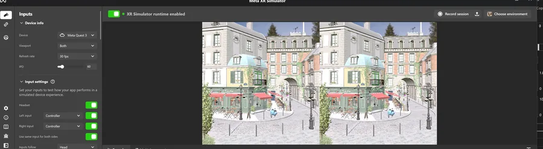
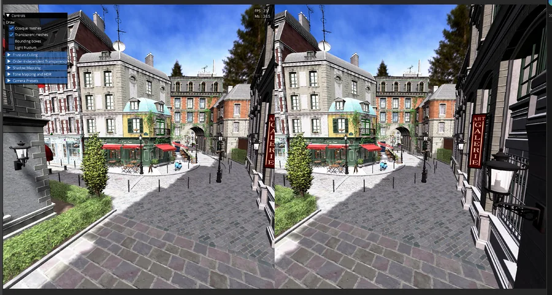
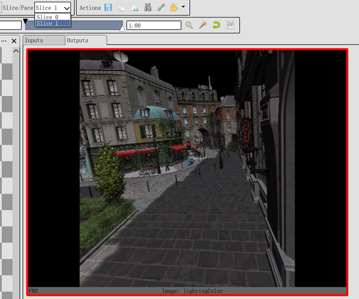
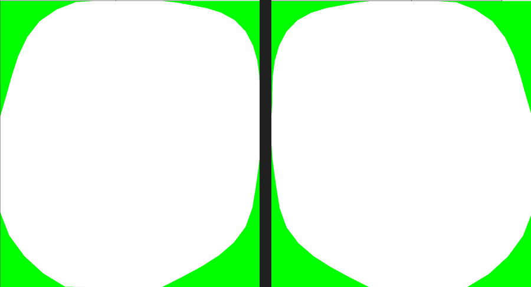
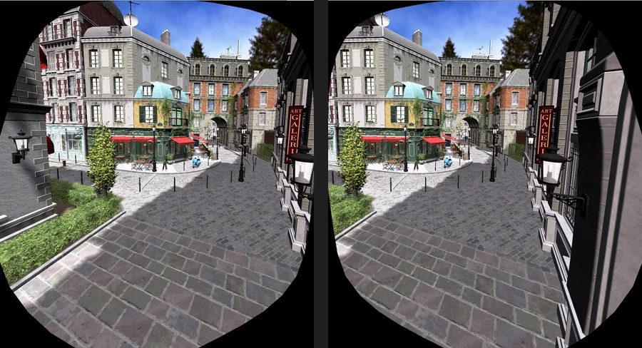
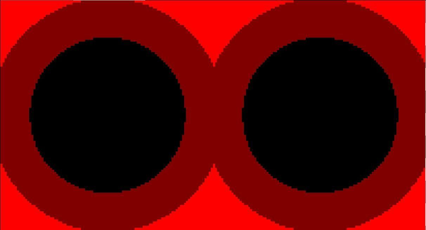

# Experiencing VR Graphics

Earlier this year, I bought a Quest 3 for my first real taste of VR games—*Half-Life: Alyx*, *SUPERHOT VR*, and a few others. BTW, while I was at it, I also added a VR mode to my LVK-based renderer; this post documents the process.

LVK provided the Vulkan abstraction, while the existing OpenXR layer handled most of the runtime, session, and input plumbing. Through OpenXR, the renderer receives the stereo view configuration, recommended image dimensions, predicted per-eye poses and FOVs, and runtime-owned swapchain images. This post therefore focuses on my part: adapting a desktop renderer—with one camera, one set of render targets, and one final image—into a stereo renderer.

## Getting the First Stereo Frame

A straightforward stereo path records the rendering pipeline once per eye. That works, but it duplicates draw submission and many state changes. Before using Multiview, the `multiview` device feature must be enabled; Vulkan 1.0 exposes it through `VK_KHR_multiview`, while Vulkan 1.1 promotes the functionality to core. [Vulkan Multiview](https://docs.vulkan.org/refpages/latest/refpages/source/VkRenderingInfo.html) then broadcasts each draw to the active views in a single rendering instance.

For the primary stereo view configuration, OpenXR reports the recommended image size for each eye. I created one two-layer OpenXR swapchain and mirrored that layout across the renderer: every G-buffer and intermediate render target changed from a 2D texture into a two-layer texture array.

```cpp
constexpr uint32_t kViewCount = 2;

ctx->createTexture({
    .format = lvk::Format::Format_R11G11B10_F,
    .dimensions = framebufferSize,
    .numLayers = kViewCount,
    .usage = lvk::TextureUsageBits_Attachment |
             lvk::TextureUsageBits_Sampled,
    .debugName = "gbuffer0",
});
```

When beginning the rendering pass, Multiview is enabled through the render pass's `viewMask`. For a conventional left/right pair, views 0 and 1 must both be active, so `viewMask` must be `0b11` (`0x3`), not `0x11`:

```cpp
buf.cmdBeginRendering(
    lvk::RenderPass{
        .color = colorAttachments,
        .depth = depthAttachment,
        .viewMask = 0b11,
    },
    framebuffer);
```

Multiview mainly removes duplicated CPU work; the GPU still shades the pixels required by both eyes. Inside a graphics shader, `gl_ViewIndex` identifies the current view and the matching framebuffer layer. I stored both cameras in the same push-constant block and selected the correct data in the vertex shader:

```cpp
struct MeshPushConstants {
    mat4 viewProj[2]; // for vertex transform
    vec4 cameraPos[2]; // for view direction computation
};
```

```glsl
gl_Position =
    pc.viewProj[gl_ViewIndex] * model * vec4(in_pos, 1.0);
```

```glsl
// lighting fragment shader
... 
f16vec3 scene = f16vec3(textureBindless2DArray(pc.sceneColor, pc.smpl, uv, gl_ViewIndex).rgb);
float depth = textureBindless2DArray(pc.depth, pc.smpl, uv, gl_ViewIndex).r;
f16vec4 g1 = f16vec4(textureBindless2DArray(pc.gbuffer1, pc.smpl, uv, gl_ViewIndex));
f16vec4 g3 = f16vec4(textureBindless2DArray(pc.gbuffer3, pc.smpl, uv, gl_ViewIndex));
...
```
The same rule applies to every later read: a former `texture2D` G-buffer lookup must become a `texture2DArray` lookup using the current view as its layer. Compute passes do not receive `gl_ViewIndex`, so I dispatch them with a Z dimension of two and derive the layer from the global invocation ID.

After fixing a few validation errors, the minimal geometry, lighting, and post-processing path produced its first stereo image:

<figure style="margin: 1.5rem auto; text-align: center;">
  
  <figcaption><em>The first stereo frame running in Meta XR Simulator.</em></figcaption>
</figure>

## Restoring the Full Renderer

Once the minimal path worked, I restored the remaining features. Most fixes came down to finding assumptions that only one view existed.

OpenXR's `xrLocateViews` supplies the predicted pose and asymmetric FOV for each eye. I converted those values into per-eye view-projection matrices and camera positions, then propagated them through world-position reconstruction and the rest of the renderer. Frustum culling required more care. An object visible to either eye must remain in the draw list; otherwise it can disappear at the edge of one eye and cause uncomfortable stereo popping.

```cpp
const bool visible =
    isBoxInFrustum(eyes[0].frustum, box) ||
    isBoxInFrustum(eyes[1].frustum, box);

if (visible) {
    command.instanceCount = 1;
}
```

This produces the union of both eyes' visible sets, while Multiview still broadcasts one draw to both layers.

The next set of changes was in screen-space rendering. Transparent rendering, order-independent transparency, bloom, tone mapping, and final composition all had to explicitly select the array layer. Eye adaptation needed one additional policy decision: I average the luminance measurements from both eyes and update one shared exposure value. Independent exposure values can make the two eyes disagree even when the underlying lighting is identical.

With those changes in place, the stereo result again matched the feature set of the desktop renderer:

<figure style="margin: 1.5rem auto; text-align: center;">
  
  <figcaption><em>The restored renderer producing the final stereo output.</em></figcaption>
</figure>

## Capturing and Debugging Multiview

Frame debugging was unexpectedly awkward. In my Meta XR Simulator workflow, launching the application through Nsight Graphics or RenderDoc did not reliably capture the XR frame. The rendering path did not behave like the desktop preview path on which the tools normally detected my frame boundary.

I solved this by integrating RenderDoc's [in-application capture API](https://github.com/baldurk/renderdoc/blob/v1.x/renderdoc/api/app/renderdoc_app.h). Wrapping the target frame with `StartFrameCapture` and `EndFrameCapture` gave me a deterministic capture point without adding a separate desktop preview window.

This was especially useful for Multiview because RenderDoc exposes each attachment layer independently. I could verify that both slices existed, inspect the G-buffer for each eye, and catch passes that accidentally sampled layer zero for both views.

<figure style="margin: 1.5rem auto; text-align: center;">
  
  <figcaption><em>Inspecting the second layer of a Multiview attachment in RenderDoc.</em></figcaption>
</figure>

## Other VR Rendering Optimization Techniques

After correctness, I added two VR-specific ways to reduce fragment work.

First, OpenXR's optional [`XR_KHR_visibility_mask`](https://registry.khronos.org/OpenXR/specs/1.1/man/html/XR_KHR_visibility_mask.html) extension provides a hidden triangle mesh for each eye: geometry that the compositor's lens distortion will never expose to the user. I upload those runtime-provided vertices and indices, clear stencil to `0`, then rasterize each hidden mesh into its matching Multiview layer with color and depth writes disabled and a stencil reference of `1`.

<figure style="margin: 1.5rem auto; text-align: center;">
  
  <figcaption><em>Left- and right-eye masks. In this visualization, the green hidden areas are marked as stencil 1; the white visible areas remain 0.</em></figcaption>
</figure>

Subsequent raster passes use a stencil comparison of `EQUAL 0`. Fragments in the untouched white region proceed normally, while fragments in the green corners fail because the hidden mesh marked them as `1`. Compute passes cannot use the fixed-function stencil test. To skip hidden-area work there as well, the visibility mask must be exposed as a sampleable resource and tested explicitly in the shader.

The debug output below makes the rejected area visible as black borders. Its shape differs between the two eyes, matching the per-eye masks above; in the headset, those borders lie outside the visible lens region.

<figure style="margin: 1.5rem auto; text-align: center;">
  
  <figcaption><em>Rendered results after applying stencil == 0. The black borders are skipped pixels.</em></figcaption>
</figure>

Second, I implemented fixed foveated rendering with Vulkan's [fragment shading rate](https://docs.vulkan.org/samples/latest/samples/extensions/fragment_shading_rate/README.html). I generate a two-layer shading-rate attachment that keeps full-rate shading in the center of each eye and uses progressively coarser rates toward the periphery. Eye-tracked foveation would instead require gaze data and a dynamically updated rate map.

<figure style="margin: 1.5rem auto; text-align: center;">
  
  <figcaption><em>Visualization of the shading-rate regions for both eyes.</em></figcaption>
</figure>

## References

- [OpenXR Tutorial](https://openxr-tutorial.com/)
- [Advanced VR Rendering](https://gdcvault.com/play/1021772/Advanced-VR)
