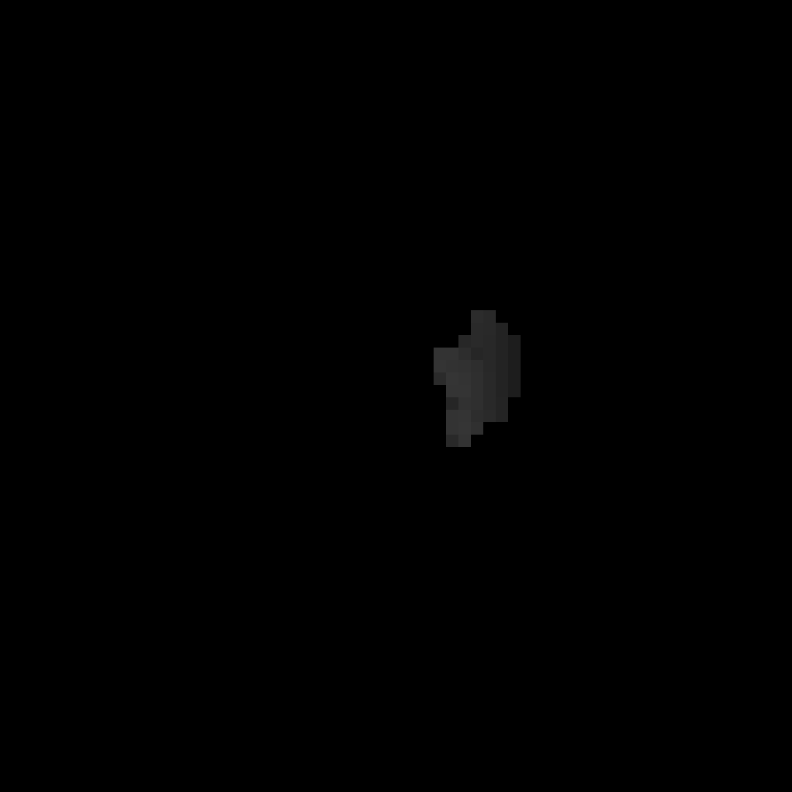

# Shadow Occlusion Culling

Shadow maps often render geometry that cannot cast shadows on anything visible to the camera. We can reduce this work by locating visible **shadow receivers** and rejecting casters that cannot shadow them.

This receiver-based approach is discussed in Ari Silvennoinen’s [*Chasing Shadows* (2012)](https://arisilvennoinen.github.io/Publications/Chasing_Shadows.pdf) and Haar and Aaltonen’s [*GPU-Driven Rendering Pipelines* (2015)](https://advances.realtimerendering.com/s2015/aaltonenhaar_siggraph2015_combined_final_footer_220dpi.pdf). This post outlines a simplified implementation for a directional light.

## Reproject Camera Depth into Light Space

Start with the camera depth buffer. Reproject each visible surface point into light space and accumulate its depth in a coarse grid. Each texel represents a tile of the shadow map; the Slang pseudocode below uses an 8 × 8 grid for illustration.

Assume light-space depth ranges from 0 to 1 and increases away from the light. Each tile stores the **maximum receiver depth**, representing the farthest visible receiver in that tile.

Clear the grid to −1 to mark empty tiles. For clarity, the pseudocode assumes support for floating-point atomic max and omits background rejection, bounds checks, and depth bias.

```hlsl
#define RECEIVER_TILE_SIZE 8

Texture2D<float> sceneDepth;
RWTexture2D<float> lightTileDepth;

float4x4 cameraClipToLightClip;
uint2 sceneDepthSize;

void reprojectLightTileDepth(float3 cameraNDC)
{
    float4 lightClip = mul(cameraClipToLightClip, float4(cameraNDC, 1));
    float3 lightNDC = lightClip.xyz / lightClip.w;
    uint2 tile = uint2((lightNDC.xy * 0.5 + 0.5) * RECEIVER_TILE_SIZE);
    InterlockedMax(lightTileDepth[tile], lightNDC.z);
}

[shader("compute")]
[numthreads(8, 8, 1)]
void main(uint3 id : SV_DispatchThreadID)
{
    uint2 pixel = id.xy;
    float depth = sceneDepth.Load(int3(pixel, 0));
    float2 uv = (float2(pixel) + 0.5) / float2(sceneDepthSize);
    float2 cameraNDC = uv * float2(2, -2) + float2(-1, 1);
    reprojectLightTileDepth(float3(cameraNDC, depth));
}
```

The resulting texture stores the farthest visible receiver depth in each light-space tile.



## Build a Receiver Depth Hierarchy

Build a mip chain by taking the maximum depth over each 2 × 2 block. Coarser levels let us query the farthest receiver depth over a large region with only a few texture reads.

| Mip 0 | Mip 1 | Mip 2 |
| --- | --- | --- |
|  |  |  |

## Cull Shadow Casters

Project each caster’s bounding box into light space and query the hierarchy over its projected rectangle. Reject the caster if the region contains no receivers, or if the caster’s nearest depth is farther from the light than the farthest receiver in the region. Otherwise, retain it as a potential shadow caster. Casters outside the camera frustum must still be considered: they may cast shadows onto visible receivers.

The query follows the same pattern as an HZB occlusion test, but the hierarchy stores receiver depths rather than rasterized occluder depths.

The images below compare the shadow map before and after caster culling.

| Before culling | After culling |
| --- | --- |
|  |  |

## Reduce Atomic Contention

TODO: Compare direct global atomic writes with wave-level reduction and workgroup-shared aggregation.

## Performance

The measurements below use a camera view inside the Bistro scene and a 4096 × 4096 D16 shadow map. The baseline renders the full scene into the shadow map without receiver-based caster culling.


Without caster culling, the shadow-map pass takes **0.42 ms**.


With caster culling, the shadow-map pass takes **0.19 ms**. This excludes the cost of generating receiver data and performing the culling tests.


Receiver reprojection, hierarchy construction, and caster culling add approximately **0.20 ms**.


For this view, the combined cost is approximately **0.39 ms** (0.19 + 0.20 ms), down from **0.42 ms**. The shadow-map pass saves 0.23 ms, but most of that saving is spent on the culling algorithm. The remaining benefit is roughly **0.03 ms**, or a **7.1% reduction in total shadow-processing time**.

## Conclusion

Shadow occlusion culling can avoid rendering casters that contribute nothing to visible shadows. How much work it saves depends on the scene and the effectiveness of the culling, while reprojection, hierarchy construction, and caster tests add their own cost. Profiling to see where the technique pays off

